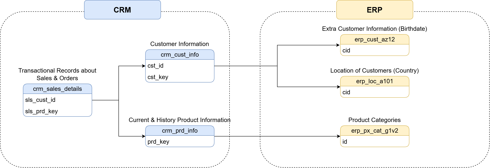
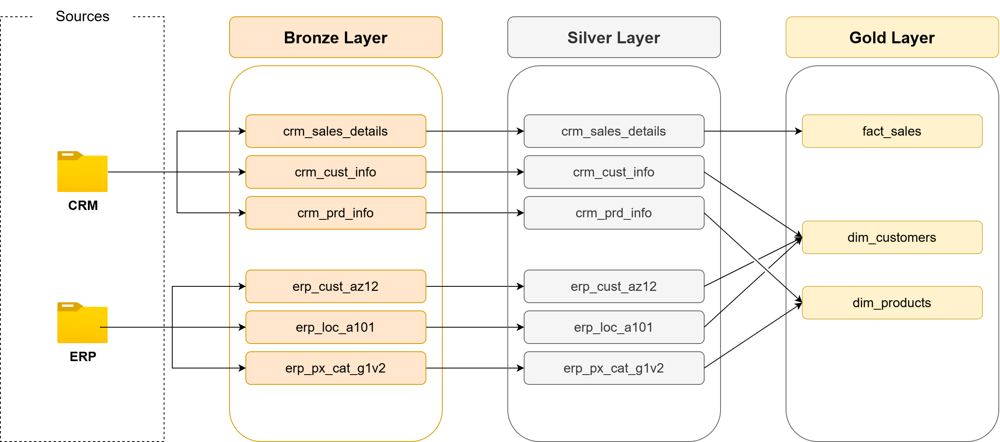

# SQL Data Warehouse Project

A modern data warehouse built with **SQL Server** using the **Medallion Architecture** (Bronze → Silver → Gold).
It integrates sales data from two source systems (CRM and ERP), cleans it, and models it into a **star schema** ready for reporting and analytics.

> Built while following the *Data with Baraa* SQL Data Warehouse course, then extended with my own additions (see [My Extensions](#my-extensions)).

---

## Data Architecture


| Layer | Purpose | Object Type | Load | Transformations |
|---|---|---|---|---|
| **Bronze** | Raw data, stored as-is from the sources | Tables | Batch, full load (truncate & insert) | None |
| **Silver** | Cleaned, standardized data | Tables | Batch, full load (truncate & insert) | Cleansing, standardization, normalization, derived columns, enrichment |
| **Gold** | Business-ready data for analytics | Views | No load | Integration, aggregation, business logic → star schema |

---

## Project Requirements

**Objective:** develop a data warehouse in SQL Server that consolidates sales data and enables analytical reporting.

- **Data sources:** two source systems (CRM and ERP) delivered as CSV files
- **Data quality:** clean and resolve data quality issues before analysis
- **Integration:** combine both sources into one user-friendly data model
- **Scope:** latest dataset only, no historization
- **Documentation:** clear documentation of the data model for business and analytics users

---

## Tech Stack

- **SQL Server Express** and **SSMS**: database and development
- **T-SQL**: DDL, stored procedures, BULK INSERT, window functions, data cleansing
- **draw.io**: architecture, integration, data flow and data model diagrams
- **Git & GitHub**: version control
- **Notion**: project planning

---

## Repository Structure

```
sql-data-warehouse-project/
├── datasets/                      # Source CSV files
│   ├── source_crm/                # cust_info, prd_info, sales_details
│   └── source_erp/                # cust_az12, loc_a101, px_cat_g1v2
├── docs/                          # Diagrams (.drawio sources + .png) and documentation
│   ├── data_architecture.png
│   ├── data_integration.png
│   ├── data_flow.png
│   ├── data_model.png
│   └── data_catalog.md            # Description of every Gold column
├── scripts/
│   ├── init_database.sql          # Creates the database and schemas
│   ├── bronze/
│   │   ├── ddl_bronze.sql         # Bronze tables
│   │   └── proc_load_bronze.sql   # Procedure: CSV -> bronze (BULK INSERT)
│   ├── silver/
│   │   ├── ddl_silver.sql         # Silver tables
│   │   └── proc_load_silver.sql   # Procedure: bronze -> silver (cleansing)
│   └── gold/
│       └── ddl_gold.sql           # Gold views (star schema)
├── tests/
│   ├── quality_checks_silver.sql  # Data quality checks for silver
│   └── quality_checks_gold.sql    # Key uniqueness and referential integrity
├── LICENSE
└── README.md
```

---

## Data Sources

| System | Files | Content |
|---|---|---|
| CRM | `cust_info`, `prd_info`, `sales_details` | Customers, products (with price history), sales transactions |
| ERP | `cust_az12`, `loc_a101`, `px_cat_g1v2` | Birth date and gender, customer country, product categories |



---

## Data Flow



---

## How to Run

1. Install SQL Server (Express is enough) and SSMS.
2. Clone the repository:
   ```
   git clone https://github.com/Asrbek-Engineer/sql-data-warehouse-project.git
   ```
3. Update the CSV file paths in `scripts/bronze/proc_load_bronze.sql` to match your machine.
4. Run the scripts in this order:

   | Step | Script | What it does |
   |---|---|---|
   | 1 | `scripts/init_database.sql` | Creates `DataWarehouse` and the `bronze`, `silver`, `gold` schemas (**drops the database if it exists**) |
   | 2 | `scripts/bronze/ddl_bronze.sql` | Creates the bronze tables |
   | 3 | `scripts/bronze/proc_load_bronze.sql` | Creates the bronze load procedure |
   | 4 | `scripts/silver/ddl_silver.sql` | Creates the silver tables |
   | 5 | `scripts/silver/proc_load_silver.sql` | Creates the silver load procedure |
   | 6 | `scripts/gold/ddl_gold.sql` | Creates the gold views |

5. Load the data:
   ```sql
   EXEC bronze.load_bronze;
   EXEC silver.load_silver;
   ```
6. Validate: run `tests/quality_checks_silver.sql` and `tests/quality_checks_gold.sql`.
   Queries marked *Expectation: No results* must return no rows.

---

## Data Model (Gold Layer)


| Object | Type | Grain |
|---|---|---|
| `gold.dim_customers` | Dimension | One row per customer |
| `gold.dim_products` | Dimension | One row per current product |
| `gold.fact_sales` | Fact | One row per order line |

Every column is described in the [Data Catalog](docs/data_catalog.md).

---

## Design Decisions

Rules applied while cleaning and modeling the data, and why:

| Area | Decision | Reason |
|---|---|---|
| Customers | Keep only the **latest record per customer** (`ROW_NUMBER` by create date) | The source contains duplicate customer IDs; the newest record is the valid one |
| Gender | **CRM is the master source**; ERP is used only when CRM is `n/a` | CRM is the system where customers are maintained |
| Codes | Codes are mapped to readable values (`M` → `Male`, `S` → `Single`, `DE` → `Germany`); unknown → `n/a` | Reports should not show cryptic codes or NULLs |
| Customer keys | The `NAS` prefix is removed from ERP customer IDs | Without it, ERP rows match the CRM `cst_key` and the join does not lose customers |
| Product history | `end_date` = the day before the next `start_date` of the same product | Source end dates were invalid (earlier than start dates); periods must not overlap |
| Products | `dim_products` keeps **only current products** (`end_date IS NULL`) | The scope is the latest data, no historization |
| Sales | `sales` is recalculated as `quantity × price` when it is missing, negative or inconsistent; `price` is derived from `sales / quantity` only when the price itself is invalid | Price and quantity are treated as the source of truth; sales is a derived value |
| Dates | Invalid integer dates (`0`, wrong length) become NULL; future birth dates become NULL | Bad values are not guessed; very old birth dates are kept on purpose |
| Gold | Built as **views** with **surrogate keys** (`ROW_NUMBER`) | Always up to date with Silver; the model does not depend on source system keys |
| Loads | Full load (truncate & insert) in stored procedures | Simple and idempotent: running the load twice gives the same result |

---

## My Extensions

Additions beyond the course:

- [x] Load procedures measure the duration of every table and of the whole batch in **milliseconds** (`SYSDATETIME()` / `DATETIME2`)
- [x] Error handling prints the error **message, number, line and state**, then **re-throws** the error (`THROW`), so a failed load is not reported as successful
- [x] Quality checks are documented with an explicit **expectation** for every query
- [ ] ETL log table: records start time, end time, duration, row count and status for every load
- [ ] Extra data quality tests
- [ ] Analytical views and reports on top of the Gold layer

---

## Future Improvements

- **Incremental load:** load only new or changed rows instead of a full reload
- **Orchestration:** schedule the loads with Airflow
- **Transformation:** move the Silver and Gold logic to dbt models with built-in tests
- **Cloud:** run the warehouse on a cloud platform

---

## Acknowledgements

This project follows the SQL Data Warehouse course by **Baraa Khatib Salkini** (*Data with Baraa*).
The architecture and datasets come from the course; the implementation, notes and extensions are my own.

---

## License

This project is licensed under the [MIT License](LICENSE).

## About Me

**Asrbek**: aspiring Data Engineer from Tashkent, Uzbekistan.

- GitHub: [Asrbek-Engineer](https://github.com/Asrbek-Engineer)