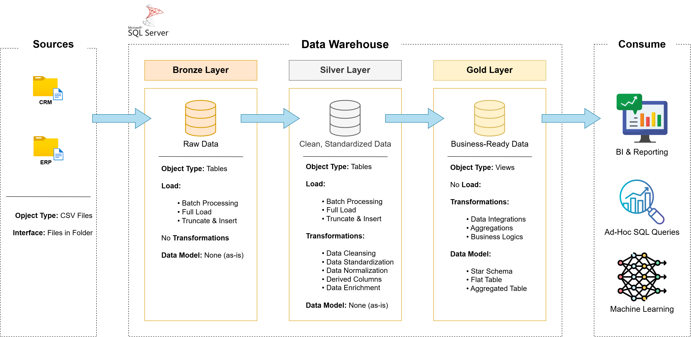
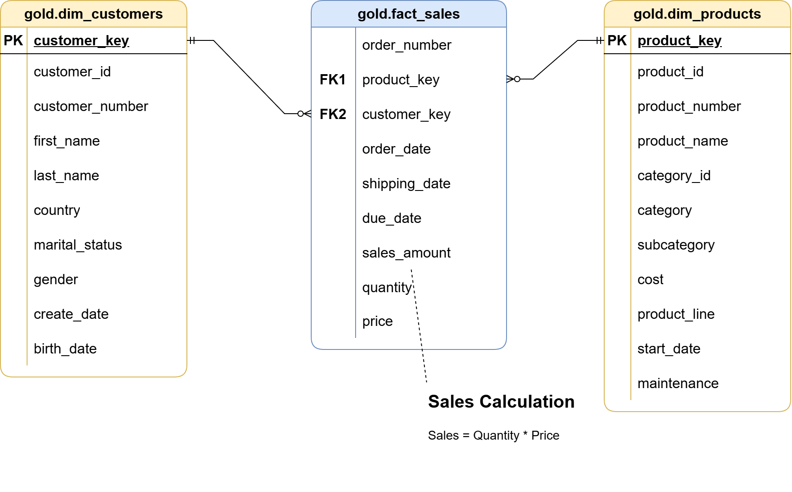

# SQL Data Warehouse Project

A modern data warehouse built with **SQL Server** using the **Medallion Architecture** (Bronze → Silver → Gold).
It integrates sales data from two source systems (CRM and ERP), cleans it, and models it into a **star schema** ready for reporting and analytics.

> Built while following the *Data with Baraa* SQL Data Warehouse course, then extended with my own additions (see [My Extensions](#my-extensions)).

---

## Data Architecture



| Layer | Purpose | Object Type | Load | Transformations |
|---|---|---|---|---|
| **Bronze** | Raw data, stored as-is from the sources | Tables | Batch, full load (truncate & insert) | None |
| **Silver** | Cleaned, standardized data | Tables | Batch, full load (truncate & insert) | Cleansing, standardization, normalization, derived columns, enrichment |
| **Gold** | Business-ready data for analytics | Views | No load | Integration, aggregation, business logic → star schema |

---

## Project Requirements

**Objective:** develop a data warehouse in SQL Server that consolidates sales data and enables analytical reporting.

- **Data sources:** two source systems (CRM and ERP) delivered as CSV files
- **Data quality:** clean and resolve data quality issues before analysis
- **Integration:** combine both sources into one user-friendly data model
- **Scope:** latest dataset only, no historization
- **Documentation:** clear documentation of the data model for business and analytics users

---

## Tech Stack

- **SQL Server Express** and **SSMS**: database and development
- **T-SQL**: DDL, stored procedures, BULK INSERT, data cleansing
- **draw.io**: architecture, data flow and data model diagrams
- **Git & GitHub**: version control
- **Notion**: project planning

---

## Repository Structure

```
sql-data-warehouse-project/
├── datasets/              # Source CSV files (CRM and ERP)
├── docs/                  # Diagrams and documentation
│   ├── data_architecture.png
│   ├── data_flow.png
│   ├── data_integration.png
│   ├── data_model.png
│   └── naming_conventions.md
├── scripts/
│   ├── init_database.sql  # Creates the database and schemas
│   ├── bronze/            # DDL and load procedure for the Bronze layer
│   ├── silver/            # DDL and load procedure for the Silver layer
│   └── gold/              # Views for the Gold layer (star schema)
├── tests/                 # Data quality checks
├── LICENSE
└── README.md
```

---

## Data Sources

| System | Files | Content |
|---|---|---|
| CRM | `cust_info`, `prd_info`, `sales_details` | Customers, products, sales transactions |
| ERP | `CUST_AZ12`, `LOC_A101`, `PX_CAT_G1V2` | Extra customer data, locations, product categories |

---

## How to Run

1. Install SQL Server (Express is enough) and SSMS.
2. Clone the repository:
   ```
   git clone https://github.com/Asrbek-Engineer/sql-data-warehouse-project.git
   ```
3. Run `scripts/init_database.sql` to create the `DataWarehouse` database and the `bronze`, `silver`, `gold` schemas.
4. Bronze: run the DDL script, then load the data:
   ```sql
   EXEC bronze.load_bronze;
   ```
5. Silver: run the DDL script, then:
   ```sql
   EXEC silver.load_silver;
   ```
6. Gold: run the view scripts in `scripts/gold/`.
7. Run the checks in `tests/` to validate data quality.

> Note: update the CSV file paths in the load procedures to match your machine.

---

## Data Model (Gold Layer)



- `gold.dim_customers`: customer dimension
- `gold.dim_products`: product dimension
- `gold.fact_sales`: sales fact table

---

## My Extensions

Additions beyond the course:

- [ ] ETL log table: records start time, end time, duration and row count for every load
- [ ] Extra data quality tests
- [ ] Analytical views on top of the Gold layer

---

## Acknowledgements

This project follows the SQL Data Warehouse course by **Baraa Khatib Salkini** (*Data with Baraa*).
The architecture and datasets come from the course; the implementation, notes and extensions are my own.

---

## License

This project is licensed under the [MIT License](LICENSE).

## About Me

**Asrbek**: aspiring Data Engineer from Tashkent, Uzbekistan.

- GitHub: [Asrbek-Engineer](https://github.com/Asrbek-Engineer)

